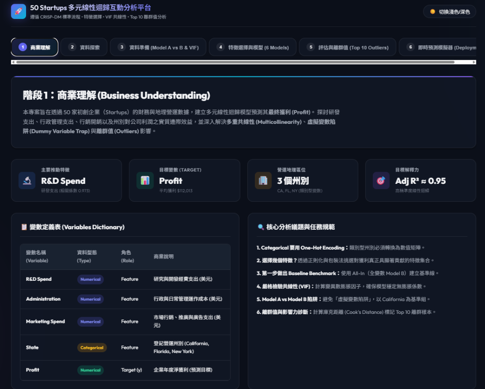

# 50 Startups 多元線性迴歸與特徵選擇 (CRISP-DM 流程)



> **🚀 互動式 Web 儀表板**：依據 CRISP-DM 標準流程建構，整合 One-Hot Encoding（Model B 避免虛擬變數陷阱）、VIF 共線性檢驗、6 大特徵選擇模型比較、Top 10 離群值檢測與即時獲利預測模擬器。  
> 🌐 **線上即時體驗網址 (GitHub Pages)**：[https://l34f-yeah.github.io/1014-DIC-2-kaggle-50-startup-and-boston-housing/](https://l34f-yeah.github.io/1014-DIC-2-kaggle-50-startup-and-boston-housing/)

本專案依據機器學習標準資料探勘流程（CRISP-DM），針對 50 家初創企業（50 Startups）的利潤預測問題進行完整建模、共線性診斷、特徵篩選、離群值檢驗與視覺化分析。

---

## 📌 專案架構與核心概念 (CRISP-DM 流程)

### 1. 商業理解 (Business Understanding)
- **問題定義**：預測 50 家初創企業的獲利（Profit）。
- **特徵欄位**：
  - `R&D Spend`（研發支出，數值型特徵）
  - `Administration`（行政支出，數值型特徵）
  - `Marketing Spend`（行銷支出，數值型特徵）
  - `State`（所屬州別，類別型特徵：California, Florida, New York）
  - `Profit`（獲利，目標變數 Target）
- **關鍵挑戰**：
  - 類別變數的編碼方式（One-Hot Encoding）。
  - 虛擬變數陷阱（Dummy Variable Trap）與完全多元共線性。
  - 特徵冗餘與多重共線性診斷（VIF）。
  - 挑選最佳特徵子集以提升模型解釋力與泛化能力。

---

### 2. 資料理解 (Data Understanding)
- 檢視資料基本結構（50 筆樣本，5 個欄位）。
- 檢驗有無缺失值（無缺失值）。
- 各特徵敘述性統計與相關係數矩陣。

---

### 3. 資料準備 (Data Preparation)
- **Model A vs Model B 差異剖析**：
  - **Model A（Full One-Hot, No Intercept）**：
    $$\hat{y} = w_1 X_{\text{CA}} + w_2 X_{\text{FL}} + w_3 X_{\text{NY}} + w_4 X_{\text{R\&D}} + w_5 X_{\text{Admin}} + w_6 X_{\text{Marketing}}$$
    保留 3 個虛擬變數，但強制設定截距項為 0 ($b = 0$)。
  - **Model B（Two Dummies, With Intercept）**（★ 本專案採用）：
    $$\hat{y} = b + w_1 X_{\text{R\&D}} + w_2 X_{\text{Admin}} + w_3 X_{\text{Marketing}} + w_4 X_{\text{FL}} + w_5 X_{\text{NY}}$$
    **為什麼只保留 FL 與 NY 兩個虛擬變數？加州（California）跑去哪裡了？**
    因為 $X_{\text{CA}} + X_{\text{FL}} + X_{\text{NY}} = 1$（完全線性相關，共線性陷阱）。若同時保留 3 個虛擬變數與截距項 $b$，會導致反矩陣無法計算（奇異矩陣）。
    因此，我們使用 `pd.get_dummies(..., drop_first=True)` 移除 California 作為**基準組（Baseline / Reference Category）**。
    當 $X_{\text{FL}} = 0$ 且 $X_{\text{NY}} = 0$ 時，該企業必然位於加州，此時**截距項 $b$ 實質上就代表加州企業的基準獲利水準**！
- **共線性診斷（VIF - Variance Inflation Factor）**：
  - 計算各特徵之 VIF 值，診斷多重共線性。
- **資料切分與標準化**：
  - 80% 訓練集，20% 測試集。
  - 對數值特徵進行標準化（StandardScaler），以利後續正則化特徵篩選（LassoCV, ElasticNetCV）。

---

### 4. 模型建置與特徵選擇 (Modeling & Feature Selection)
本專案共比較 **6 個迴歸模型**：
1. **Baseline Linear Regression**：使用 Model B 的全部 5 個特徵（All-In 模型）。
2. **LassoCV**：L1 正則化，透過 5-Fold 交叉驗證自動挑選最佳懲罰參數 $\alpha$，將不重要特徵係數直接壓縮為 0，實現自動特徵選取。
3. **RFECV**：遞迴特徵消除法（Recursive Feature Elimination with CV），逐步剃除權重最小的特徵，找出使 CV 誤差最小的特徵子集。
4. **Sequential Forward Selection (SFS)**：前向逐步特徵選擇，從 0 個特徵開始，每次貪婪地加入對模型表現提升最大的特徵。
5. **ElasticNetCV**：結合 L1 與 L2 正則化（L1-ratio 與 $\alpha$ 網格搜尋），克服高度共線性特徵的選擇盲點。
6. **Exhaustive Feature Selection (EFS / Best Subset)**：窮舉所有可能特徵子集組合（$2^5 - 1 = 31$ 種），找出全域最佳特徵組合。

---

### 5. 模型評估 (Evaluation)
- **評估指標**：
  - $R^2$（決定係數）
  - **Adjusted $R^2$（調整後決定係數）**：
    $$\text{Adjusted } R^2 = 1 - \frac{(1 - R^2)(n - 1)}{n - k - 1}$$
    （懲罰過多的無用特徵，基準約在 0.9495 左右）
  - **RMSE**（均方根誤差）
  - **MAE**（平均絕對誤差）
- **離群值檢測 (Top 10 Outliers Detection)**：
  - 計算庫克距離（Cook's Distance）與學生化殘差（Studentized Residuals）。
  - 以 $4/n$ 作為影響力點門檻值，精確標示出對迴歸線影響最大的 Top 10 樣本。

---

### 6. 視覺化部署產出 (Visualizations & Deployment)
執行程式後將生成以下成果檔案：
- `startups_regression_analysis.png`：4 合 1 高解析度分析圖表
  1. 實際值 vs 預測值散布圖（含迴歸擬合線、完美預測線與 Top 10 離群值標記）
  2. 殘差圖（Residuals vs Fitted Values，檢驗同質變異與獨立性）
  3. 庫克距離（Cook's Distance）影響力圖
  4. 6 大模型 Adjusted $R^2$ 與 RMSE 雙軸條形比較圖
- `feature_selection_matrix.png`：6 大特徵選擇方法之特徵挑選熱力矩陣。
- `model_comparison_results.csv`：各模型指標數據表。
- `top_10_outliers.csv`：Top 10 離群值詳細數據表。

---

## 🚀 執行方式

```bash
# 執行完整分析腳本
python startup_multiple_regression.py
```
